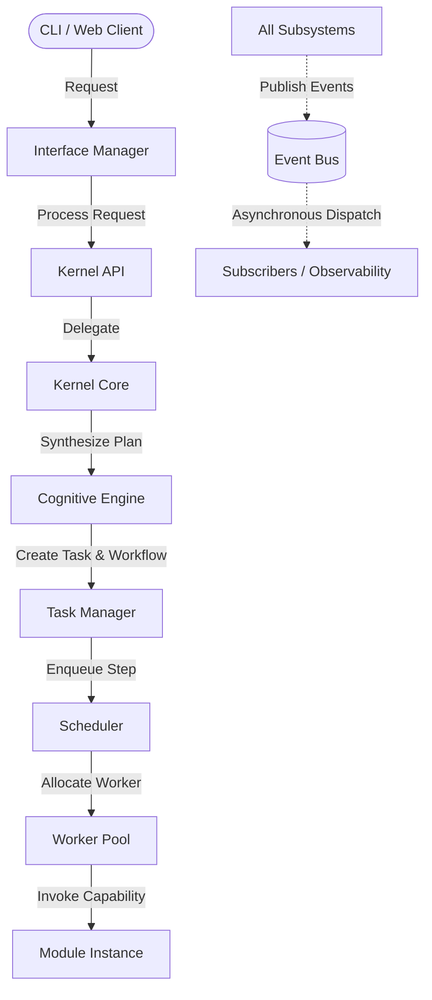

# Realtimex System Architecture & Event Reference

This document covers the architectural layout, core subsystems, and the event taxonomy of the Realtimex Kernel.

---

## 1. System Architecture

Realtimex is built as an event-driven, decoupled kernel platform. All subsystem communications flow asynchronously through a centralized Event Bus.

### Decoupled Core Layers:
1. **Interface Layer**: Translates external requests into standard kernel `Request` formats.
2. **Cognitive & Planning Layer**: Synthesizes structured execution steps and workflow dependencies using LLM routing.
3. **Execution Layer**: Manages task lifecycle queues, schedules execution units, and routes capability execution to workers.
4. **Capability Layer**: Discovers, loads, and executes modules matching requested interfaces.
5. **Observability & Recovery**: Listens to system events to record metrics, log diagnostics, and create recovery snapshots.

---

## 2. Asynchronous Event Bus

The Event Bus is the communication backbone of Realtimex. It features:
- **Thread-safe Dispatch**: Any number of threads may publish events concurrently.
- **Priority-aware Queuing**: A `queue.PriorityQueue` processes `CRITICAL` events before `NORMAL` or `LOW` ones.
- **Asynchronous Execution**: A dedicated background dispatcher thread picks events from the queue, preventing publishers from blocking.
- **Graceful Shutdown**: Placing a `_SentinelEvent` on the queue notifies the dispatcher to stop after draining remaining events.

---

## 3. Event Type Reference

Event type constants are centralized under `events/event_types.py` to avoid magic strings and ensure strict interface matching.

### Kernel Lifecycle (`KernelEventType`)
Emitted during boot, shutdown, and restart cycles:
- `KernelBootStarted` — Boot sequence initiated.
- `ConfigurationLoaded` — Kernel config file successfully loaded.
- `LoggerInitialized` — Logger configuration applied.
- `EventBusInitialized` — Event bus instantiated.
- `ServiceRegistryInitialized` — Core services ready for registration.
- `ServiceRegistryReady` — Core services fully wired.
- `CapabilityRegistryInitialized` — Registry mapping capabilities created.
- `CapabilityRegistryReady` — Registry mapping ready for module loadings.
- `RecoveryInitialized` — Recovery systems active.
- `ModulesLoaded` — All discovered modules loaded.
- `KernelReady` — Initialization complete, operational loop running.
- `KernelOperational` — Operational health confirmed.
- `KernelShutdownStarted` — Shutdown sequence triggered.
- `KernelShutdownComplete` — Core subsystems shutdown, loop stopped.
- `KernelShutdown` — Process termination.
- `KernelRestartRequested` — Sequential reboot requested.

### Module Lifecycle (`ModuleEventType`)
Emitted by the Module Loader and Registry:
- `ModuleDiscovered` — Module directory matched.
- `ModuleValidated` — Manifest validated against schema.
- `ModuleLoaded` — Entry point instantiated and ready.
- `ModuleFailed` — Module directory validation or load failed.
- `ModuleUnloaded` — Module unloaded from registry.
- `CapabilityRegistered` — A single capability linked to a provider module.
- `ServiceRegistered` — A system service registered.

### Event System Lifecycle (`EventSystemEventType`)
Emitted by the Event Bus / Manager:
- `EventBusStarted` — Background dispatcher thread running.
- `EventBusShutdown` — Bus stopped accepting new events.
- `SubscriberRegistered` — Listener added.
- `SubscriberUnregistered` — Listener removed.
- `EventDispatchFailed` — Subscriber raised exception during event dispatch.
- `EventPersisted` — Event logged to disk.
- `EventReplayStarted` — Historical replay stream opened.
- `EventReplayCompleted` — Historical replay completed.

### Task Lifecycle (`TaskEventType`)
Emitted by the Task Manager:
- `TaskCreated` — New user task initialized.
- `TaskUpdated` — Task metadata or progress changed.
- `TaskPaused` — Execution suspended.
- `TaskResumed` — Execution resumed.
- `TaskCancelled` — Task manually stopped.
- `TaskCompleted` — Goal accomplished successfully.
- `TaskFailed` — Execution failed, unrecoverable.
- `TaskRecovered` — Task recovered via recovery manager.
- `TaskDeleted` — Task purged from active list.
- `ProgressUpdated` — Completion percentage increased.

### Worker & Scheduler Lifecycle (`WorkerEventType` & `SchedulerEventType`)
Emitted during task allocation and execution:
- `WorkerStarted` — Worker runner initialized.
- `WorkerAssigned` — Task unit bound to worker.
- `WorkerExecutionStarted` — Worker began processing unit.
- `WorkerExecutionFinished` — Worker finished capability execution.
- `WorkerReportGenerated` — Execution results logged.
- `WorkerFailed` — Worker process failed or crashed.
- `WorkerRecovered` — Worker recovered state.
- `WorkerTerminated` — Worker destroyed.
- `HeartbeatReceived` — Worker reported status.
- `StepQueued` — Plan step enqueued in Scheduler.
- `StepDispatched` — Step popped from scheduler queue.
- `WorkerAllocated` — Worker bound to plan step.
- `WorkerReleased` — Worker released back to pool.
- `RetryScheduled` — Failed step scheduled for retry.
- `QueueEmpty` — Scheduler queue empty.
- `SchedulerStarted` — Scheduler thread running.
- `SchedulerStopped` — Scheduler thread stopped.
